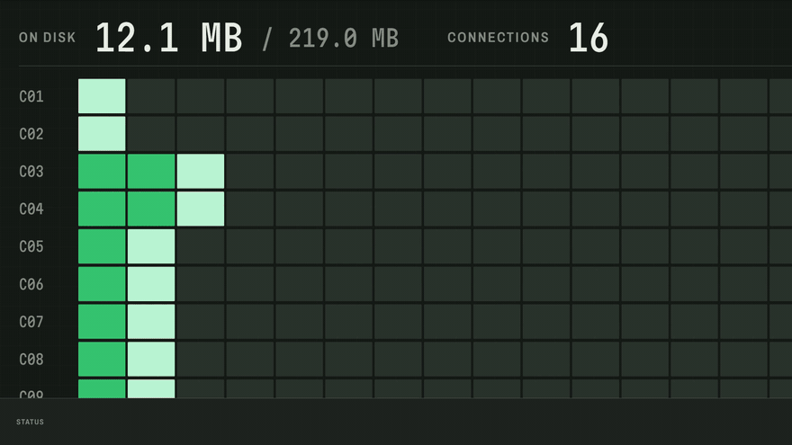

# Zoltraak

### A modern, browser-integrated download manager for Windows — built with Rust + Tauri.

 

  

Sixteen connections, one file. &nbsp;·&nbsp; <a href="https://giran03.github.io/Zoltraak/">Watch the full motion showcase ↗</a>

  

[**User Guide**](https://giran03.github.io/Zoltraak/guide.html) &nbsp;·&nbsp; [**Features**](#-features) &nbsp;·&nbsp; [**Privacy & security**](#-privacy--security)

 

> [!NOTE]
> **No accounts, no license keys, no activation.** Every feature works as soon as Zoltraak is installed.

 

> [!NOTE]
> **Linux compatibility:** Zoltraak can run on Linux, but it has not yet been fully tested there. Windows remains the primary supported platform.

## ✦ Features

<table>
  <tr>
    <td width="50%" valign="top">
      <h3>⚡ Segmented downloads</h3>
      Many connections per file with work stealing, durable resume and retry, a SQLite-backed queue with priorities, bounded concurrency and crash recovery.
    </td>
    <td width="50%" valign="top">
      <h3>🎬 Video capture</h3>
      Direct, HLS and DASH video downloads with quality selection and automatic merging of separate audio and video streams.
    </td>
  </tr>
  <tr>
    <td width="50%" valign="top">
      <h3>🎵 Music capture</h3>
      Spotify, Apple Music, Deezer, YouTube, SoundCloud and Bandcamp links become tagged audio files with cover art, lyrics and the format you choose.
    </td>
    <td width="50%" valign="top">
      <h3>🔁 Convert</h3>
      Local video, audio, image and animation conversion with FFmpeg — MP4 ↔ GIF, JPEG ↔ PNG, audio extraction and stream-copy repackaging.
    </td>
  </tr>
  <tr>
    <td width="50%" valign="top">
      <h3>🧩 Browser extension</h3>
      A Manifest V3 extension pairs with the app over a token-authenticated loopback API, forwarding the cookies and <code>Referer</code> a gated download needs.
    </td>
    <td width="50%" valign="top">
      <h3>📨 Discord delivery</h3>
      Send finished files to a channel by webhook or bot — oversized media is re-encoded as a <em>copy</em> to fit the server's real upload limit.
    </td>
  </tr>
</table>

<table>
  <tr>
    <td width="33%" valign="top">
      <h4>📂 Categories</h4>
      Route downloads to folders by extension, domain or regex.
    </td>
    <td width="33%" valign="top">
      <h4>⏱️ Scheduler</h4>
      A daily window plus on-completion actions once the queue drains.
    </td>
    <td width="33%" valign="top">
      <h4>🔎 History</h4>
      Search and filter every download the queue has recorded.
    </td>
  </tr>
  <tr>
    <td width="33%" valign="top">
      <h4>🔐 Encrypted sessions</h4>
      Browser sessions live in an AES-256-GCM vault, minimised and forgettable.
    </td>
    <td width="33%" valign="top">
      <h4>🖥️ Headless CLI</h4>
      <code>zoltraak</code> runs the same engine in a Windows terminal, no webview needed.
    </td>
    <td width="33%" valign="top">
      <h4>⏸️ Pause ≠ close</h4>
      Pauses persist across restarts; closing the app resumes on next launch.
    </td>
  </tr>
</table>

> [!TIP]
> **Tested the hard way:** a 219 MB file over 16 connections, forcibly stopped mid-transfer, then restarted — it resumed from the 35 MB already on disk and the SHA-256 matched the publisher's hash.

 

## 🎬 Video

The **Video** tab supports direct files, HLS and DASH streams, with dedicated
extractors for Facebook, Instagram, TikTok, X, Reddit, Vimeo and YouTube.
Separate audio and video streams are merged locally with FFmpeg.

YouTube support is best-effort and depends on its changing client policies.
Restricted videos may require a signed-in browser session.

 

## 🎵 Music

The **Music** tab supports tracks, albums, playlists, artists and song searches,
with batch downloads, format conversion and automatic tagging.

| Source | What Zoltraak gets |
|---|---|
| Spotify, Apple Music, Deezer | Track details and artwork; the audio is matched on YouTube Music by title, artist and duration. Nothing is decrypted. |
| YouTube, YouTube Music, SoundCloud, Bandcamp | The audio stream directly (Bandcamp serves 128 kbps MP3). |

YouTube-sourced music requires a signed-in browser session shared by the extension.

- **Formats** — `best` (original stream, no re-encode), MP3, AAC/M4A, Opus, Ogg Vorbis, FLAC, ALAC or WAV.
- **Tags and cover art** — title, artist, album, track numbers, date and genre, with the real album sleeve looked up when the source only has a video still.
- **Files** — `{artist} - {title}` filename templates, album/playlist folders, optional `cover.jpg`/`folder.jpg`, `.m3u8`, synced lyrics and loudness normalisation.
- **Already downloaded** tracks are skipped, so re-running a playlist link is cheap.

 

## 🔁 Convert

The **Convert** tab converts local video, audio, images and animations with
FFmpeg — MP4 ↔ GIF, JPEG ↔ PNG, audio extraction, recompression and
container repackaging that copies streams instead of re-encoding where it can.
Your source file is always preserved.

 

## 📨 Discord

Finished files can be delivered to a Discord channel automatically or from the
right-click menu through a **webhook** or **bot**. Files over the server's upload
limit are re-encoded as a smaller *copy*; archives and documents are skipped
with a reason. **The download on your disk is never modified.**

 

## 🔐 Privacy & security

The browser extension connects to a token-authenticated local API. Requests
from ordinary websites are rejected, and browser credentials stay on your device.

Browser sessions shared by the extension are treated like your browser's own cookie jar:

- **Minimised** — only the cookies a sign-in needs; tracking cookies never leave the browser.
- **Encrypted at rest** — AES-256-GCM vault, with its key protected by Windows DPAPI. Discord credentials live in the same vault.
- **Never stored with downloads** and never logged.
- **Removable** — saved browser sessions can be deleted at any time.

 

---

**Zoltraak** &nbsp;·&nbsp; Rust + Tauri

<a href="LICENSE">MIT License</a> &nbsp;·&nbsp; <a href="https://giran03.github.io/Zoltraak/guide.html">User Guide</a> &nbsp;·&nbsp; <a href="https://giran03.github.io/Zoltraak/">Showcase</a>

